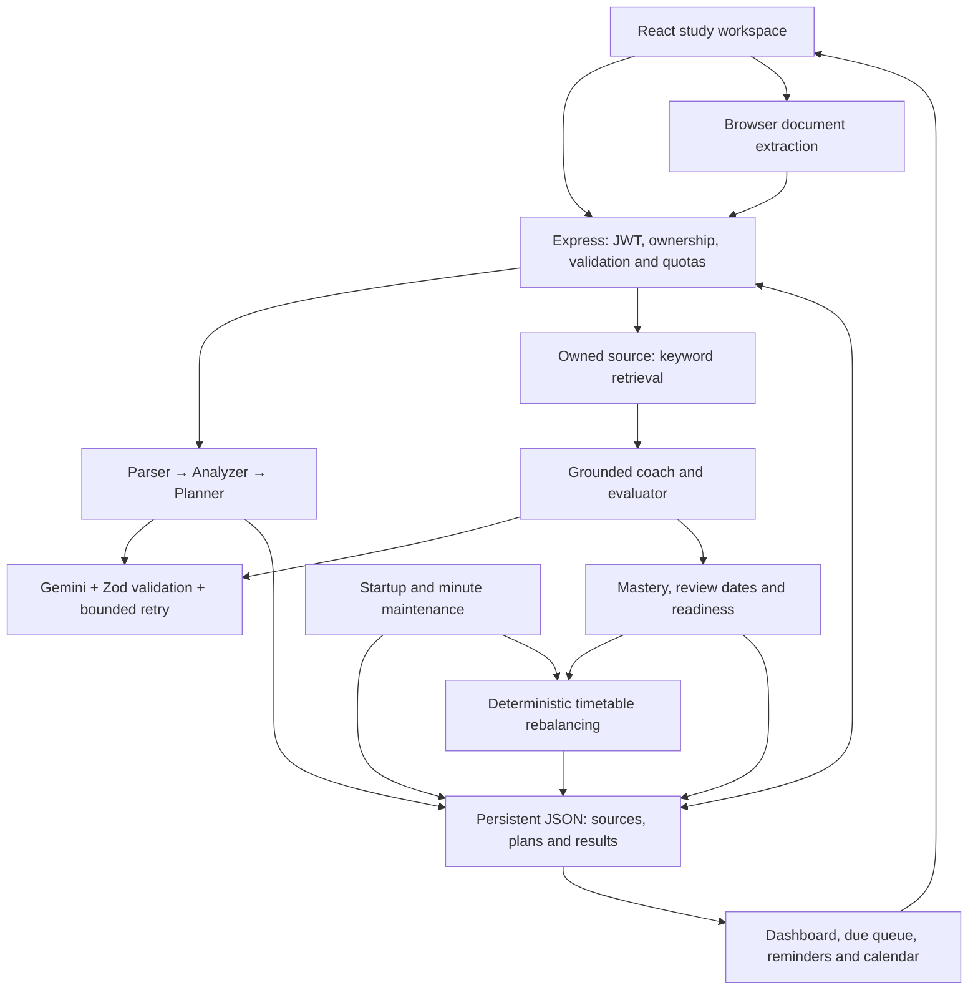

# StudySniper

**Turn your syllabus into a study plan that changes when your performance changes.**

StudySniper is an exam-preparation workspace: upload course material, schedule available hours, practice weak topics, and track readiness across sessions.

## Problem and solution

Students often have a syllabus, scattered notes and a deadline—but no reliable connection between what they planned, what they actually studied and what they can answer. A useful initial timetable becomes outdated after a missed day or a poor mock result.

StudySniper connects those activities through persisted topic IDs, assessment results, review dates and scheduled tasks. AI extracts and explains the material; deterministic application logic updates mastery, allocates remaining time and maintains reminders.

## Why not just ChatGPT?

A chatbot can explain a topic or draft a timetable. StudySniper's value is the integrated, exam-specific workflow and verifiable saved state. The claim is not that general assistants can never offer memory, files or reminders; it is that this application connects those capabilities around one syllabus without the student manually transferring results between prompts.

| Student need | What this implementation does | Demonstration |
|---|---|---|
| Remember progress | Saves sources, plans, assessments, topic mastery and review dates per account | Reload after a graded quiz |
| Recover from missed work | Reallocates pending tasks while preserving completed work | Inspect the demo's missed-day replan |
| Respond to weak results | Adds bounded reinforcement below 70% and rebalances | Submit a low-scoring mapped quiz |
| Revise at useful intervals | Maintains 1/3/7/14/30-day review queues | Review a due topic or card |
| Use the actual syllabus | Retrieves passages from an owned source and validates supporting quotes | Inspect source evidence; ask a source-specific question |
| Know what remains | Shows assessed coverage and weighted readiness, including unassessed topics | Compare dashboard before and after a quiz |
| Follow through | Persists in-app reminders and exports a calendar snapshot | Open the bell and download `.ics` |

Readiness is a transparent practice heuristic, **not a validated prediction of exam marks**. Retrieved quotes improve traceability, not proof that every generated claim is correct.

## Architecture

The implemented stack is **React 19 + TypeScript + Vite, Express 4, JWT, Gemini and a single-process JSON database**. Google sign-in through Firebase is optional. MongoDB and Anthropic were in the original brief; neither migration is implemented in this release.



| Code | Responsibility |
|---|---|
| `src/components/` | Planner, tutor, quizzes, dashboard, documents and revision UI |
| `src/utils/documentParser.ts` | Bounded PDF, office-document and text extraction |
| `server/routes/` | Authenticated, owner-scoped HTTP operations |
| `server/agents/` | Agent prompts, runtime schemas and validated pipeline stages |
| `server/services/retrieval.ts` | Overlapping text chunks and keyword ranking |
| `server/services/learning.ts` | Mastery, readiness, fixed reviews and task allocation |
| `server/services/progress.ts` | Missed-day maintenance and persistent notifications |
| `server/db.ts` | Atomic JSON persistence, rollback and single-writer protection |
| `scripts/seed-demo.ts` | Synthetic demo data with a random-password local account |
| `tests/` | Security, parsing, agent and learning regression checks |

### Syllabus-to-plan pipeline

1. **Parser:** extracts units, topics, explicit percentage weightage and ISO exam dates, with source quotes. An entered exam date overrides all units.
2. **Analyzer:** estimates topic difficulty and importance; users can set priorities in the advanced flow before planning.
3. **Planner:** produces dated tasks. Runtime validation checks topic coverage, deadlines and daily capacity.
4. **Coach/evaluator:** creates source-grounded practice or mixed-topic mocks and grades answers. Results update the corresponding topics.

These are specialized stages using one configured model, not independently trained agents. Each model output must satisfy a Zod schema and relevant evidence/ID checks; malformed output gets one retry. Completed stages persist so later failures can be resumed.

## Local setup

Use Node.js **22.16+** and npm. Node 24 was used for previous runtime checks.

```sh
git clone https://github.com/satya-sri-karri/StudySniper_Internship.git
cd StudySniper_Internship
npm ci
```

Copy `.env.example` to `.env`:

```powershell
# Windows PowerShell
Copy-Item .env.example .env
```

```sh
# macOS / Linux
cp .env.example .env
```

Generate a unique secret and paste the output into `JWT_SECRET`:

```sh
node -e "console.log(require('crypto').randomBytes(48).toString('hex'))"
```

For the fastest local demonstration, set `ENABLE_DEMO=true` and retain `NODE_ENV=development`. Then:

```sh
npm run dev
```

Open **http://localhost:3000**, choose **Sign In → Open isolated demo account**. No AI or SMTP credentials are needed to use the saved demo plan, quiz, revision queue, readiness and calendar export. Each demo account is isolated and its synthetic history is visibly labeled.

The fixture includes six weighted networking topics, a deadline 14 days away, three historical mocks, weak and unassessed topics, missed and completed tasks, six cards, source notes and a mapped TCP quiz. For a reusable local login, **stop the server**, run `npm run seed:demo`, retain the printed random credentials privately, then restart against the same `DATA_DIR`. The JSON backend must have only one writer.

### Optional services

| Capability | Environment configuration |
|---|---|
| New AI generation | `GEMINI_API_KEY`, `GEMINI_MODEL` available to your project |
| Email signup, OTP and recovery | `SMTP_HOST`, `SMTP_PORT`, `SMTP_SECURE`, `SMTP_USER`, `SMTP_PASS`, `SMTP_FROM` |
| Google sign-in | Matching server `FIREBASE_API_KEY` / `FIREBASE_PROJECT_ID` and browser `VITE_FIREBASE_*`; enable Google auth and authorize your domain in Firebase |
| Storage and port | `DATA_DIR` (persistent local disk), `PORT` (default 3000) |

The server loads `.env.local` then `.env`, without overriding host-provided variables. Never put private AI keys or JWT secrets in `VITE_*`. Firebase browser settings are public project configuration. Missing external credentials produce explicit errors; the app does not fabricate successful AI responses or expose OTPs.

## Main user flow

1. Open **Study Planner**, choose a readable syllabus, exam date and daily hours, then click **Upload & create my plan**.
2. Inspect extracted topics and the saved timetable. **Advanced: plan from an existing source** supports reuse, explicit priorities and resuming incomplete stages.
3. Take topic practice, a mixed-topic mock, or a standalone quiz explicitly mapped through **Track mastery**. Unmapped quizzes do not affect syllabus readiness.
4. Inspect updated mastery, readiness, review dates and timetable. Open **Revision Engine** for due work.
5. Use the header bell for in-app reminders and **Export calendar (.ics)** for an importable snapshot.

The quick flow targets under one minute with a **55-second client deadline** and at most **50 seconds of server AI work**. Live provider speed has not been verified. If it times out, completed stages remain saved; if only the upload completed, select that source in Advanced. A topic-only syllabus can support planning, but meaningful quizzes require explanatory notes in the selected source.

## Learning behavior and boundaries

- **Mastery:** rounded mean of a topic's latest five graded results. Repeated submission of the same assessment does not add evidence twice. Standalone quizzes retain their latest 50 attempts and use normalized exact matching; agent practice uses LLM grading against source evidence.
- **Readiness:** each topic starts at zero until assessed. Topic readiness is `round(mastery × (0.5 + 0.5 × min(attempts / 3, 1)) × overdueFactor)`, where the factor is `0.85` for an overdue review and `1` otherwise. Exam readiness is the rounded weighted mean of those topic values. Explicit percentages are used when every topic has one and at least one is positive; otherwise estimated importance is used. Self-review does not directly raise mastery.
- **Replanning:** scores below 70% add up to 30 minutes of reinforcement, with at most one pending reinforcement task per topic. Pending tasks are ordered by deadline, lower mastery and higher priority; completed work is preserved. Work that cannot fit is shown as **Unscheduled**. Capacity is per timetable, not shared across separate plans.
- **Spaced repetition:** success advances through 1, 3, 7, 14 and 30 days; Again/Hard resets to one day. Repeated same-day success does not accelerate the interval. All stored schedule and review dates use UTC.
- **Grounding:** keyword retrieval uses 1,200-character chunks at a 1,000-character stride and returns up to six matching chunks. There is no vector database or embedding model. Unsupported evidence is rejected, but quote matching cannot establish semantic correctness. Saved tutor conversations are visible history; each new question is independently retrieved, so ask explicit questions rather than ambiguous follow-ups.
- **Reminders:** maintained at startup, each minute while the server runs and on relevant requests. Delivery is in-app, not email, browser push or OS notifications. Calendar export is an all-day `.ics` snapshot, not Google Calendar synchronization; re-imports may duplicate entries.
- **Documents:** up to 10 MB per file, 100 PDF pages/PPTX slides and 200,000 extracted characters. Planning has stricter limits of 30,000 characters and 60 topics. Scans need external OCR; legacy DOC/PPT are rejected. Optional summaries use at most the first 20,000 characters and label that scope.
- **Usage bounds:** 20 saved pipelines, 100 assessments per pipeline, and at most 15 least-assessed topics per mock. AI requests have per-user rate limits and two concurrent requests per user. These limits are process-local and reset on restart.

## Security and deployment

JWTs expire after two hours. Logout and password changes revoke older sessions. Routes enforce ownership; requests and model output are validated. Upload extraction has size/expansion limits. Private keys remain server-side. Account deletion requires local-password confirmation or fresh Google reauthentication and removes owned records.

```sh
npm run lint
npm test
npm run build
npm start
```

`lint` is a TypeScript check, not ESLint. `npm start` runs the production bundle and serves the built frontend; demo access is disabled in production. Set `NODE_ENV=production` explicitly on the host. Use HTTPS, one Node process and a persistent local disk for `DATA_DIR`. Set `TRUST_PROXY_HOPS` to your actual trusted proxy count; leave it at zero for direct localhost use. Keep `ALLOW_PREVIEW_FRAME=false` unless intentionally embedding in the supported preview origin.

The JSON store uses atomic replacement, rolls back failed writes and rejects competing writers or corrupt storage. Back up the entire data directory before updates. Do not run replicas, share it over a network filesystem or use ephemeral storage. MongoDB migration, distributed jobs and production-scale testing remain future work.

## Validation and jury materials

The Step 5 implementation passed **42 regression tests**, TypeScript validation, the production build and production HTTP smoke checks. Chromium checks covered the one-click flow, demo navigation and a 390px mobile viewport with no page errors or page overflow. Automated AI responses were mocked; live Gemini, SMTP and Firebase credentials remain unverified. These checks are not a measured learning-outcome study or a full accessibility audit.

- [Three-minute demo script](docs/DEMO_SCRIPT.md): timed narration, exact clicks and a provider-independent presentation route.
- [Ten jury questions and answers](docs/JURY_QA.md): concise, defensible explanations with implementation evidence.
- [Step 6 change log](STEP6_CHANGELOG.md) and [complete changed contents](STEP6_FULL_CHANGED_FILES.md).
- Historical implementation records: [Step 2](STEP2_CHANGELOG.md), [Step 3](STEP3_CHANGELOG.md), [Step 4](STEP4_CHANGELOG.md), [Step 5](STEP5_CHANGELOG.md).
