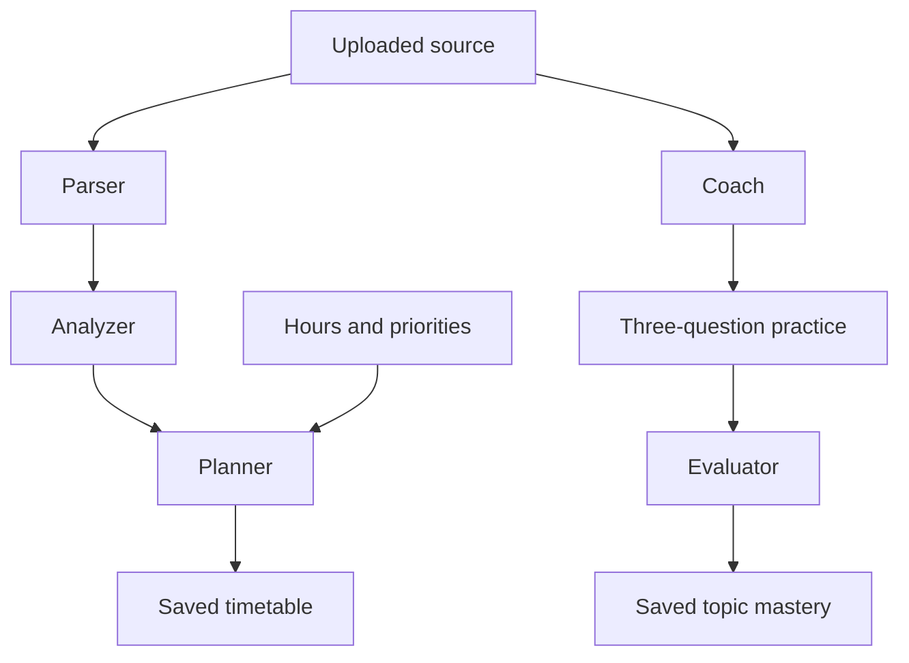

# StudySniper AI — validated syllabus agents

A React study workspace with tutor chat, document Q&A, quizzes, flashcards, notes, a study planner, and activity summaries. This release fixes the audited security and reliability problems. Step 3 adds a validated syllabus-to-plan pipeline and source-grounded practice with saved topic mastery. Adaptive replanning, scheduled reminders, spaced-repetition due queues and overall readiness scoring remain subsequent steps.

## Actual stack

React 19, TypeScript, Vite, Express 4, a single-process JSON database, JWT authentication, optional Google sign-in via Firebase, and Gemini. MongoDB and Anthropic migration are not part of this maintenance step. Zod is the only added production dependency, for request and model-output validation.

## Setup

Use Node.js 22.16+ (tested with Node 24) and npm. Run commands inside the extracted project directory.

```sh
npm ci
```

Copy `.env.example` to `.env` (PowerShell: `Copy-Item .env.example .env`; macOS/Linux: `cp .env.example .env`). Generate a secret:

```sh
node -e "console.log(require('crypto').randomBytes(48).toString('hex'))"
```

Paste that value into `JWT_SECRET` in `.env`. The server refuses a missing or example secret. Server configuration reads `.env.local`, then `.env`, without overriding environment variables supplied by the host.

- **Local email accounts:** configure all SMTP fields. Signup requires an email OTP. Codes are never returned in HTTP responses or shown in the UI. Failed or unconfigured email delivery produces an error.
- **Google sign-in (optional):** configure the three `VITE_FIREBASE_*` variables and matching server `FIREBASE_API_KEY`/`FIREBASE_PROJECT_ID`; enable Google in Firebase Authentication and authorize the app domain. These Firebase browser values are public configuration. The backend validates an ID token with Firebase and checks its project, identity, expiry and verification status. Email-only identity claims are rejected. Firebase REST reference: https://firebase.google.com/docs/reference/rest/auth
- **AI:** configure `GEMINI_API_KEY` and a model available to your project in `GEMINI_MODEL`. No key means explicit errors when generating content, not invented results. Existing fixtures and study records remain usable.
- Never put a private API key or JWT secret in a `VITE_*` variable.

```sh
npm run dev
```

Open http://localhost:3000. Set `PORT` to change it.

## Isolated demo without external services

For local development only, set `ENABLE_DEMO=true`. Open Sign In → **Open isolated demo account**. Each click creates a separate synthetic account with a real document, a flashcard and a two-question quiz; no shared public password and no email/AI calls are needed. New AI generation still requires a configured provider.

Alternatively stop the server and run `npm run seed:demo` to create a synthetic local account. Its newly generated credentials print once to your terminal. Run the server again and sign in with those credentials. Do not publish them. Production always disables the demo endpoint, even if the flag is set.

The release does not bundle the uploaded ZIP's account/hash/history database. The original upload remains the backup. To preserve an existing deployment, back up its entire `data` directory and keep using the same `DATA_DIR`; never overwrite it with demo data.

## Validation and production

```sh
npm run lint
npm test
npm run build
npm start
```

`lint` performs a TypeScript check; it is not ESLint. Tests use temporary databases and mocked external services. `npm start` serves the built frontend and backend in production mode. Server source is built under `build/`, outside public `dist/`. Set `NODE_ENV=production` explicitly in hosted environments as well.

Use a persistent disk for `DATA_DIR`, with one Node process. Startup refuses a competing writer or corrupt database; writes use atomic replacement and roll back memory on failure. If a crash leaves a lock, the server checks the owning process before removing it. Do not use replicas, network-shared filesystems, or ephemeral storage for this JSON backend. MongoDB migration remains separate work.

Set `TRUST_PROXY_HOPS` only to the actual number of trusted reverse proxies (default zero). Deploy behind HTTPS. Leave `ALLOW_PREVIEW_FRAME=false` except when deliberately embedding in the supported preview origin.

## Behavior changes to know

- JWTs expire after two hours. Logout revokes all StudySniper sessions for that user; password reset/change also revokes older tokens.
- Local and Google identities have separate recovery flows. Google users manage passwords with Google. Existing local users marked unverified must verify their email. Legacy Firebase rows migrate only when their stored UID matches a verified Firebase identity.
- Account deletion requires the current local password or a fresh Google reauthentication, and removes the account's study records. Google deletion is performed before local data removal; if a local disk failure follows, retain the backup and resolve the failed local cleanup before continuing.
- Quiz/flashcard generation requires an owned uploaded source. Keyword retrieval considers the whole extracted document; generated questions/cards must include matching source quotes. Document answers expose supporting excerpts or report insufficient evidence. Citation checks improve traceability but do not prove semantic correctness; review generated material before relying on it.
- Model JSON gets at most two attempts and must satisfy runtime schemas. Plans must use real dates within the exam window and fit the daily hours. There is no adaptive rescheduling in this step.
- Quizzes are graded on the server. MCQ and text answers use normalized exact matching, not substring matching. The separate syllabus-agent practice flow uses source-grounded LLM grading; existing standalone quizzes retain exact matching. Attempt history is retained (latest 50 per quiz).
- PDF/DOCX/PPTX and listed text formats are limited to 10 MB; PDFs/PPTX to 100 pages/slides; extracted text to 200,000 characters. Scanned PDFs need prior OCR. Legacy DOC/PPT are rejected rather than falsely “indexed.” Archive expansion is bounded. The PDF worker ships locally.
- Document upload saves real extracted text even if an optional AI summary fails; the summary is clearly labeled as a source preview. Long-document summaries explicitly identify their first-20,000-character scope. Note-generation input is capped at 20,000 characters.
- AI requests have per-user hourly limits, two concurrent requests per user, and bounded provider timeouts. Limits are local to this single server process and reset on restart.
- Flashcards retain the existing review history; due-date spaced repetition is still pending. Dashboard hours are estimates, not measured readiness. The timer is not persisted. Static notifications were removed rather than presented as proactive reminders.

See `STEP2_CHANGELOG.md` for audit coverage, validation evidence, and every changed file with its full workspace path. `STEP2_FULL_CHANGED_FILES.md` contains complete changed source files; the npm lockfile is supplied separately in full.


## Step 3: syllabus agents

Open **Study Planner → Syllabus → plan → practice** after uploading a readable syllabus in Documents.

1. Select the source, available hours, and optional exam-date override; click **Parse & analyze syllabus**.
2. Review extracted units/topics and source evidence. Missing weightage stays unknown. Difficulty and importance are explicitly AI estimates. Set your priorities from 1 to 5.
3. Click **Generate day-wise plan**. Every topic must be covered within its exam window and the total daily time budget. The result also appears in the existing timetable checklist.
4. Click **Practice** on a topic, answer three questions, then **Grade answers & update mastery**. Feedback, evidence and assessment history persist across reloads. Mastery is the arithmetic mean of that topic's completed practice scores; it is not an exam prediction.



Each agent uses its own prompt and runtime Zod schema, with at most two provider attempts for invalid JSON, wrong IDs or unsupported evidence. These are specialized stages using the same configured Gemini model; no extra agent framework or dependency is installed. Each stage is a separate bounded request, so completed stages survive a later failure. There is no under-one-minute guarantee: provider latency and retries determine completion time.

- Parsing supports up to 30,000 extracted characters and 60 topics; larger documents are explicitly rejected instead of silently truncated. PDF extraction uses the existing bounded parser.
- Dates are accepted from the source only when explicitly ISO-formatted; provide an override for missing, past or differently formatted dates. The override applies to every unit. Weightage is extracted only when expressed as a percentage.
- Topic headings support planning, but practice requires explanatory evidence in the selected document. Insufficient evidence fails visibly; upload syllabus plus notes together for substantive quizzes.
- Agent-created assessments are separate from legacy standalone quizzes. Only the new practice flow updates pipeline topic mastery in this step. Auto-replanning and integration into the Analytics Dashboard remain Step 4.
- Agent routes use the same authenticated per-user rate and concurrency limits. Run-specific locking prevents duplicate concurrent stage writes; repeated completed stage/evaluation requests do not duplicate plans or mastery updates.
- Old databases automatically initialize the new `pipelines` collection. Account deletion removes it with the user's other data. Deleting a pipeline explicitly keeps its separately saved timetable.
- Limits: 20 saved pipelines and 100 assessments per pipeline. Source quotes improve traceability, but semantic evaluation remains an AI estimate requiring review.

Tests use mocked provider responses and temporary databases. Live Gemini/SMTP/Firebase calls and browser/mobile visual checks have not been verified in this environment.
