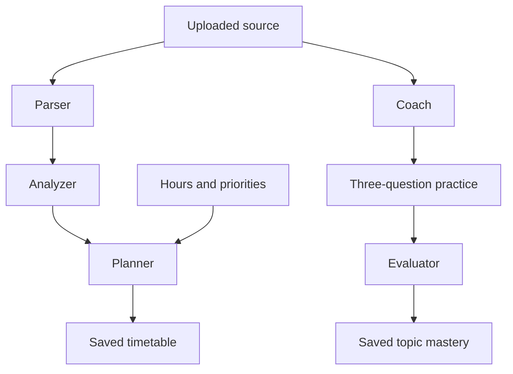

# StudySniper AI — validated syllabus agents

A React study workspace with tutor chat, document Q&A, quizzes, flashcards, notes, a study planner, and activity summaries. This release fixes the audited security and reliability problems. Step 3 adds a validated syllabus-to-plan pipeline and source-grounded practice with saved topic mastery. Step 4 adds automatic replanning, fixed review queues, in-app reminders, calendar export and evidence-based readiness indicators.

## Actual stack

React 19, TypeScript, Vite, Express 4, a single-process JSON database, JWT authentication, optional Google sign-in via Firebase, and Gemini. MongoDB and Anthropic migration are not part of this maintenance step. Zod is the only added production dependency, for request and model-output validation.

## Setup

Use Node.js 22.16+ (tested with Node 24) and npm. Run commands inside the extracted project directory.

```sh
npm ci
```

Copy `.env.example` to `.env` (PowerShell: `Copy-Item .env.example .env`; macOS/Linux: `cp .env.example .env`). Generate a secret:

```sh
node -e "console.log(require('crypto').randomBytes(48).toString('hex'))"
```

Paste that value into `JWT_SECRET` in `.env`. The server refuses a missing or example secret. Server configuration reads `.env.local`, then `.env`, without overriding environment variables supplied by the host.

- **Local email accounts:** configure all SMTP fields. Signup requires an email OTP. Codes are never returned in HTTP responses or shown in the UI. Failed or unconfigured email delivery produces an error.
- **Google sign-in (optional):** configure the three `VITE_FIREBASE_*` variables and matching server `FIREBASE_API_KEY`/`FIREBASE_PROJECT_ID`; enable Google in Firebase Authentication and authorize the app domain. These Firebase browser values are public configuration. The backend validates an ID token with Firebase and checks its project, identity, expiry and verification status. Email-only identity claims are rejected. Firebase REST reference: https://firebase.google.com/docs/reference/rest/auth
- **AI:** configure `GEMINI_API_KEY` and a model available to your project in `GEMINI_MODEL`. No key means explicit errors when generating content, not invented results. Existing fixtures and study records remain usable.
- Never put a private API key or JWT secret in a `VITE_*` variable.

```sh
npm run dev
```

Open http://localhost:3000. Set `PORT` to change it.

## Isolated demo without external services

For local development only, set `ENABLE_DEMO=true`. Open Sign In → **Open isolated demo account**. Each click creates a separate synthetic account with a real document, a flashcard and a two-question quiz; no shared public password and no email/AI calls are needed. New AI generation still requires a configured provider.

Alternatively stop the server and run `npm run seed:demo` to create a synthetic local account. Its newly generated credentials print once to your terminal. Run the server again and sign in with those credentials. Do not publish them. Production always disables the demo endpoint, even if the flag is set.

The release does not bundle the uploaded ZIP's account/hash/history database. The original upload remains the backup. To preserve an existing deployment, back up its entire `data` directory and keep using the same `DATA_DIR`; never overwrite it with demo data.

## Validation and production

```sh
npm run lint
npm test
npm run build
npm start
```

`lint` performs a TypeScript check; it is not ESLint. Tests use temporary databases and mocked external services. `npm start` serves the built frontend and backend in production mode. Server source is built under `build/`, outside public `dist/`. Set `NODE_ENV=production` explicitly in hosted environments as well.

Use a persistent disk for `DATA_DIR`, with one Node process. Startup refuses a competing writer or corrupt database; writes use atomic replacement and roll back memory on failure. If a crash leaves a lock, the server checks the owning process before removing it. Do not use replicas, network-shared filesystems, or ephemeral storage for this JSON backend. MongoDB migration remains separate work.

Set `TRUST_PROXY_HOPS` only to the actual number of trusted reverse proxies (default zero). Deploy behind HTTPS. Leave `ALLOW_PREVIEW_FRAME=false` except when deliberately embedding in the supported preview origin.

## Behavior changes to know

- JWTs expire after two hours. Logout revokes all StudySniper sessions for that user; password reset/change also revokes older tokens.
- Local and Google identities have separate recovery flows. Google users manage passwords with Google. Existing local users marked unverified must verify their email. Legacy Firebase rows migrate only when their stored UID matches a verified Firebase identity.
- Account deletion requires the current local password or a fresh Google reauthentication, and removes the account's study records. Google deletion is performed before local data removal; if a local disk failure follows, retain the backup and resolve the failed local cleanup before continuing.
- Quiz/flashcard generation requires an owned uploaded source. Keyword retrieval considers the whole extracted document; generated questions/cards must include matching source quotes. Document answers expose supporting excerpts or report insufficient evidence. Citation checks improve traceability but do not prove semantic correctness; review generated material before relying on it.
- Model JSON gets at most two attempts and must satisfy runtime schemas. Plans must use real dates within the exam window and fit the daily hours. Step 4 automatically reschedules missed work and adds reinforcement after low scores.
- Quizzes are graded on the server. MCQ and text answers use normalized exact matching, not substring matching. The separate syllabus-agent practice flow uses source-grounded LLM grading; existing standalone quizzes retain exact matching. Attempt history is retained (latest 50 per quiz).
- PDF/DOCX/PPTX and listed text formats are limited to 10 MB; PDFs/PPTX to 100 pages/slides; extracted text to 200,000 characters. Scanned PDFs need prior OCR. Legacy DOC/PPT are rejected rather than falsely “indexed.” Archive expansion is bounded. The PDF worker ships locally.
- Document upload saves real extracted text even if an optional AI summary fails; the summary is clearly labeled as a source preview. Long-document summaries explicitly identify their first-20,000-character scope. Note-generation input is capped at 20,000 characters.
- AI requests have per-user hourly limits, two concurrent requests per user, and bounded provider timeouts. Limits are local to this single server process and reset on restart.
- Revision Engine contains due topics and flashcards with fixed review intervals. Dashboard hours remain estimates; readiness is separately calculated from graded evidence. The timer is not persisted. In-app reminders reflect actual study/review work.

See `STEP2_CHANGELOG.md` for audit coverage, validation evidence, and every changed file with its full workspace path. `STEP2_FULL_CHANGED_FILES.md` contains complete changed source files; the npm lockfile is supplied separately in full.


## Step 3: syllabus agents

Open **Study Planner → Syllabus → plan → practice** after uploading a readable syllabus in Documents.

1. Select the source, available hours, and optional exam-date override; click **Parse & analyze syllabus**.
2. Review extracted units/topics and source evidence. Missing weightage stays unknown. Difficulty and importance are explicitly AI estimates. Set your priorities from 1 to 5.
3. Click **Generate day-wise plan**. Every topic must be covered within its exam window and the total daily time budget. The result also appears in the existing timetable checklist.
4. Click **Practice** on a topic, answer three questions, then **Grade answers & update mastery**. Feedback, evidence and assessment history persist across reloads. Mastery is the mean of the latest five graded results for that topic; it is not an exam prediction.



Each agent uses its own prompt and runtime Zod schema, with at most two provider attempts for invalid JSON, wrong IDs or unsupported evidence. These are specialized stages using the same configured Gemini model; no extra agent framework or dependency is installed. The advanced flow uses separate requests; the quick flow chains stages in one bounded request. Completed stages survive a later failure. There is no under-one-minute guarantee: provider latency and retries determine completion time.

- Parsing supports up to 30,000 extracted characters and 60 topics; larger documents are explicitly rejected instead of silently truncated. PDF extraction uses the existing bounded parser.
- Dates are accepted from the source only when explicitly ISO-formatted; provide an override for missing, past or differently formatted dates. The override applies to every unit. Weightage is extracted only when expressed as a percentage.
- Topic headings support planning, but practice requires explanatory evidence in the selected document. Insufficient evidence fails visibly; upload syllabus plus notes together for substantive quizzes.
- Agent practice and mixed-topic mocks update topic mastery. In Quiz Generator, choose “Track mastery” to link a standalone quiz to the same pipeline/topic; existing unmapped quizzes remain usable without affecting readiness.
- Agent routes use the same authenticated per-user rate and concurrency limits. Run-specific locking prevents duplicate concurrent stage writes; repeated completed stage/evaluation requests do not duplicate plans or mastery updates.
- Old databases automatically initialize the new `pipelines` collection. Account deletion removes it with the user's other data. Deleting a pipeline explicitly keeps its separately saved timetable.
- Limits: 20 saved pipelines and 100 assessments per pipeline. Source quotes improve traceability, but semantic evaluation remains an AI estimate requiring review.

Tests use mocked provider responses and temporary databases. Browser smoke checks passed for readiness, planner/calendar export, topic review and reminder dismissal at desktop width and a 390 px mobile viewport, with no page errors or mobile page overflow. Live Gemini/SMTP/Firebase credentials remain unverified.


## Step 4: persistent feedback and revision

**Feedback loop.** Topic practice, mixed-topic mocks and explicitly mapped quizzes update the topic's latest-five-result mastery average. Mock questions carry topic IDs, so each topic gets its own score. Repeated submission of the same assessment does not count twice. Standalone quiz requests may send an `attemptId`; legacy callers deduplicate identical answers to the same quiz within a UTC day, within the retained 50-attempt history. New questions provide stronger evidence than repeating known answers.

**Adaptive timetable.** A deterministic scheduler adds up to 30 minutes of focused reinforcement when a topic scores below 70%, keeping at most one pending reinforcement task per topic. Missed days trigger automatic replanning at server startup, once per minute while running, and when relevant screens refresh. Pending work is ordered by deadline, lower mastery and higher user priority; completed work is preserved. Tasks can split across days. Time that cannot fit remains explicitly **Unscheduled**, never silently discarded. Daily capacity is per timetable, including that timetable's completed work on each date; separate timetables do not share a global budget. A lower new daily budget cannot undo work already completed. Use **Update & rebalance** to change hours or override all exam dates.

**Revision Engine.** Both topics and cards use intervals of **1, 3, 7, 14 and 30 days**. Successful review advances one step; Again/Hard resets to 1 day. At the final step, the interval remains 30 days. Same-day successful grading cannot accelerate the interval. Early self-review submissions are rejected; upcoming cards can still be browsed. Topic self-review updates review timing only, not mastery. Graded scores of at least 70% count as successful review.

**Readiness.** Dashboard shows each syllabus/exam and every topic, including topics not yet assessed. Topic readiness = mastery × (0.5 + 0.5 × min(attempts / 3, 1)), with a 15% reduction when its review is overdue. Unassessed topics contribute zero. Overall readiness is a weighted mean: explicit syllabus percentages are used when every topic has one and their sum is positive; otherwise estimated importance is used consistently. The UI shows the chosen weighting. This heuristic is transparent but is **not a validated prediction of exam marks**.

**Grounding.** AI Tutor now requires an owned uploaded source and shows supporting excerpts. Document Q&A, question generation and mock exams likewise use retrieved source text, with runtime quote validation and refusal when evidence is insufficient. The tutor validates the complete answer before emitting it; a saved conversation provides history for the learner, while each question is independently retrieved against the selected source. Ask explicit questions rather than relying on ambiguous follow-ups. Keyword retrieval and evidence quotes do not prove semantic correctness.

**Reminders and calendar.** The header bell shows persistent, owner-scoped reminders for today's tasks, due reviews, replanning and insufficient capacity. Dismissal persists; unresolved work gets a new reminder the next day. A single-process timer maintains reminders and plans each minute, and screens poll while open. This is in-app delivery, not email, browser push or an OS background notification. All stored schedule/review dates use **UTC**. Calendar export produces an RFC 5545 `.ics` snapshot of incomplete scheduled tasks as all-day events; import into Google Calendar or another calendar app. Re-export after changes; it is not live synchronization, and calendar clients may duplicate imports. Reference: https://www.rfc-editor.org/rfc/rfc5545

**Quick verification.** Create a pipeline and plan; take Practice or a mixed-topic mock (up to 15 least-assessed topics per mock); submit a weak answer; inspect the updated timetable, readiness and next review date. For standalone Quiz Generator, choose a “Track mastery” topic before generating. Open Revision Engine, review a due item and confirm it leaves the due queue. Inspect the bell, dismiss a reminder, reload, and export the timetable.

No new production dependencies were added for Step 4. Database migration adds the notifications collection and initializes revision/history metadata for existing pipelines. All changes and complete file contents are recorded in `STEP4_CHANGELOG.md` and `STEP4_FULL_CHANGED_FILES.md`. Earlier Step 2/3 change documents remain historical snapshots.


## Step 5: quick start and instant demo

In **Study Planner**, choose a readable syllabus, exam date and daily hours, then click **Upload & create my plan**. The file is saved without a redundant AI summary; parser, analyzer and planner run automatically and open the saved timetable. PDF, DOCX, PPTX, TXT and Markdown are supported (10 MB file limit; 30,000 extracted characters for planning). Scanned PDFs need OCR outside this app.

The target is under one minute, with a 55-second client deadline and at most 50 seconds for server AI work. Provider latency, retries, document complexity and network speed can prevent completion. Saved parser/analyzer progress can be resumed under **Saved plans & topic practice**; an uploaded source remains available under Advanced. This is a time budget, not a verified live-provider speed guarantee.

For an instant local demo, set `ENABLE_DEMO=true` in `.env`, run `npm run dev`, and choose the landing page demo button. Each click creates an isolated synthetic workspace. No AI or email credentials are required to explore the saved plan, take the saved TCP quiz, update readiness, review due cards, view reminders or export the calendar. New AI generation still requires `GEMINI_API_KEY`. Demo mode is disabled in production.

Alternatively, with the application stopped, run `npm run seed:demo`. It prints a unique email and randomly generated password for local sign-in. Restart the app against the same `DATA_DIR`; do not run the seed concurrently with the single-process JSON database server. Never commit the generated database or credentials.

The seed includes six weighted networking topics, a 14-day deadline, three historical mock results, two unassessed topics, a missed study task, completed tasks, six revision cards, source notes and a mapped TCP recovery quiz. The amber demo banner identifies synthetic history and provides four navigation shortcuts. Answer **TCP**, **acknowledgements**, and **Retransmissions** in the saved quiz to see real server-graded feedback update the demo's topic mastery.

Step 5 adds no dependencies. Full paths, explanations and complete changed contents are in `STEP5_CHANGELOG.md` and `STEP5_FULL_CHANGED_FILES.md`.
