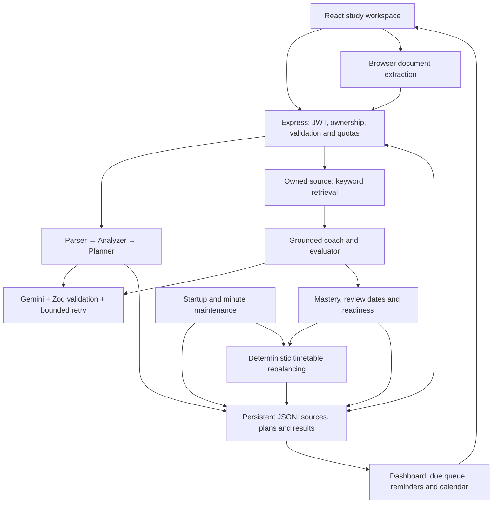

# Step 6 — complete changed document contents

Reports themselves are excluded to avoid recursive duplication.

## /workspace/scratch/3acea0dbcacf/study-sniper-audit/README.md

Rewrite the product overview, comparison, Mermaid architecture, setup, behavior and operational limits.

````markdown
# StudySniper

**Turn your syllabus into a study plan that changes when your performance changes.**

StudySniper is an exam-preparation workspace: upload course material, schedule available hours, practice weak topics, and track readiness across sessions.

## Problem and solution

Students often have a syllabus, scattered notes and a deadline—but no reliable connection between what they planned, what they actually studied and what they can answer. A useful initial timetable becomes outdated after a missed day or a poor mock result.

StudySniper connects those activities through persisted topic IDs, assessment results, review dates and scheduled tasks. AI extracts and explains the material; deterministic application logic updates mastery, allocates remaining time and maintains reminders.

## Why not just ChatGPT?

A chatbot can explain a topic or draft a timetable. StudySniper's value is the integrated, exam-specific workflow and verifiable saved state. The claim is not that general assistants can never offer memory, files or reminders; it is that this application connects those capabilities around one syllabus without the student manually transferring results between prompts.

| Student need | What this implementation does | Demonstration |
|---|---|---|
| Remember progress | Saves sources, plans, assessments, topic mastery and review dates per account | Reload after a graded quiz |
| Recover from missed work | Reallocates pending tasks while preserving completed work | Inspect the demo's missed-day replan |
| Respond to weak results | Adds bounded reinforcement below 70% and rebalances | Submit a low-scoring mapped quiz |
| Revise at useful intervals | Maintains 1/3/7/14/30-day review queues | Review a due topic or card |
| Use the actual syllabus | Retrieves passages from an owned source and validates supporting quotes | Inspect source evidence; ask a source-specific question |
| Know what remains | Shows assessed coverage and weighted readiness, including unassessed topics | Compare dashboard before and after a quiz |
| Follow through | Persists in-app reminders and exports a calendar snapshot | Open the bell and download `.ics` |

Readiness is a transparent practice heuristic, **not a validated prediction of exam marks**. Retrieved quotes improve traceability, not proof that every generated claim is correct.

## Architecture

The implemented stack is **React 19 + TypeScript + Vite, Express 4, JWT, Gemini and a single-process JSON database**. Google sign-in through Firebase is optional. MongoDB and Anthropic were in the original brief; neither migration is implemented in this release.



| Code | Responsibility |
|---|---|
| `src/components/` | Planner, tutor, quizzes, dashboard, documents and revision UI |
| `src/utils/documentParser.ts` | Bounded PDF, office-document and text extraction |
| `server/routes/` | Authenticated, owner-scoped HTTP operations |
| `server/agents/` | Agent prompts, runtime schemas and validated pipeline stages |
| `server/services/retrieval.ts` | Overlapping text chunks and keyword ranking |
| `server/services/learning.ts` | Mastery, readiness, fixed reviews and task allocation |
| `server/services/progress.ts` | Missed-day maintenance and persistent notifications |
| `server/db.ts` | Atomic JSON persistence, rollback and single-writer protection |
| `scripts/seed-demo.ts` | Synthetic demo data with a random-password local account |
| `tests/` | Security, parsing, agent and learning regression checks |

### Syllabus-to-plan pipeline

1. **Parser:** extracts units, topics, explicit percentage weightage and ISO exam dates, with source quotes. An entered exam date overrides all units.
2. **Analyzer:** estimates topic difficulty and importance; users can set priorities in the advanced flow before planning.
3. **Planner:** produces dated tasks. Runtime validation checks topic coverage, deadlines and daily capacity.
4. **Coach/evaluator:** creates source-grounded practice or mixed-topic mocks and grades answers. Results update the corresponding topics.

These are specialized stages using one configured model, not independently trained agents. Each model output must satisfy a Zod schema and relevant evidence/ID checks; malformed output gets one retry. Completed stages persist so later failures can be resumed.

## Local setup

Use Node.js **22.16+** and npm. Node 24 was used for previous runtime checks.

```sh
git clone https://github.com/satya-sri-karri/StudySniper_Internship.git
cd StudySniper_Internship
npm ci
```

Copy `.env.example` to `.env`:

```powershell
# Windows PowerShell
Copy-Item .env.example .env
```

```sh
# macOS / Linux
cp .env.example .env
```

Generate a unique secret and paste the output into `JWT_SECRET`:

```sh
node -e "console.log(require('crypto').randomBytes(48).toString('hex'))"
```

For the fastest local demonstration, set `ENABLE_DEMO=true` and retain `NODE_ENV=development`. Then:

```sh
npm run dev
```

Open **http://localhost:3000**, choose **Sign In → Open isolated demo account**. No AI or SMTP credentials are needed to use the saved demo plan, quiz, revision queue, readiness and calendar export. Each demo account is isolated and its synthetic history is visibly labeled.

The fixture includes six weighted networking topics, a deadline 14 days away, three historical mocks, weak and unassessed topics, missed and completed tasks, six cards, source notes and a mapped TCP quiz. For a reusable local login, **stop the server**, run `npm run seed:demo`, retain the printed random credentials privately, then restart against the same `DATA_DIR`. The JSON backend must have only one writer.

### Optional services

| Capability | Environment configuration |
|---|---|
| New AI generation | `GEMINI_API_KEY`, `GEMINI_MODEL` available to your project |
| Email signup, OTP and recovery | `SMTP_HOST`, `SMTP_PORT`, `SMTP_SECURE`, `SMTP_USER`, `SMTP_PASS`, `SMTP_FROM` |
| Google sign-in | Matching server `FIREBASE_API_KEY` / `FIREBASE_PROJECT_ID` and browser `VITE_FIREBASE_*`; enable Google auth and authorize your domain in Firebase |
| Storage and port | `DATA_DIR` (persistent local disk), `PORT` (default 3000) |

The server loads `.env.local` then `.env`, without overriding host-provided variables. Never put private AI keys or JWT secrets in `VITE_*`. Firebase browser settings are public project configuration. Missing external credentials produce explicit errors; the app does not fabricate successful AI responses or expose OTPs.

## Main user flow

1. Open **Study Planner**, choose a readable syllabus, exam date and daily hours, then click **Upload & create my plan**.
2. Inspect extracted topics and the saved timetable. **Advanced: plan from an existing source** supports reuse, explicit priorities and resuming incomplete stages.
3. Take topic practice, a mixed-topic mock, or a standalone quiz explicitly mapped through **Track mastery**. Unmapped quizzes do not affect syllabus readiness.
4. Inspect updated mastery, readiness, review dates and timetable. Open **Revision Engine** for due work.
5. Use the header bell for in-app reminders and **Export calendar (.ics)** for an importable snapshot.

The quick flow targets under one minute with a **55-second client deadline** and at most **50 seconds of server AI work**. Live provider speed has not been verified. If it times out, completed stages remain saved; if only the upload completed, select that source in Advanced. A topic-only syllabus can support planning, but meaningful quizzes require explanatory notes in the selected source.

## Learning behavior and boundaries

- **Mastery:** rounded mean of a topic's latest five graded results. Repeated submission of the same assessment does not add evidence twice. Standalone quizzes retain their latest 50 attempts and use normalized exact matching; agent practice uses LLM grading against source evidence.
- **Readiness:** each topic starts at zero until assessed. Topic readiness is `round(mastery × (0.5 + 0.5 × min(attempts / 3, 1)) × overdueFactor)`, where the factor is `0.85` for an overdue review and `1` otherwise. Exam readiness is the rounded weighted mean of those topic values. Explicit percentages are used when every topic has one and at least one is positive; otherwise estimated importance is used. Self-review does not directly raise mastery.
- **Replanning:** scores below 70% add up to 30 minutes of reinforcement, with at most one pending reinforcement task per topic. Pending tasks are ordered by deadline, lower mastery and higher priority; completed work is preserved. Work that cannot fit is shown as **Unscheduled**. Capacity is per timetable, not shared across separate plans.
- **Spaced repetition:** success advances through 1, 3, 7, 14 and 30 days; Again/Hard resets to one day. Repeated same-day success does not accelerate the interval. All stored schedule and review dates use UTC.
- **Grounding:** keyword retrieval uses 1,200-character chunks at a 1,000-character stride and returns up to six matching chunks. There is no vector database or embedding model. Unsupported evidence is rejected, but quote matching cannot establish semantic correctness. Saved tutor conversations are visible history; each new question is independently retrieved, so ask explicit questions rather than ambiguous follow-ups.
- **Reminders:** maintained at startup, each minute while the server runs and on relevant requests. Delivery is in-app, not email, browser push or OS notifications. Calendar export is an all-day `.ics` snapshot, not Google Calendar synchronization; re-imports may duplicate entries.
- **Documents:** up to 10 MB per file, 100 PDF pages/PPTX slides and 200,000 extracted characters. Planning has stricter limits of 30,000 characters and 60 topics. Scans need external OCR; legacy DOC/PPT are rejected. Optional summaries use at most the first 20,000 characters and label that scope.
- **Usage bounds:** 20 saved pipelines, 100 assessments per pipeline, and at most 15 least-assessed topics per mock. AI requests have per-user rate limits and two concurrent requests per user. These limits are process-local and reset on restart.

## Security and deployment

JWTs expire after two hours. Logout and password changes revoke older sessions. Routes enforce ownership; requests and model output are validated. Upload extraction has size/expansion limits. Private keys remain server-side. Account deletion requires local-password confirmation or fresh Google reauthentication and removes owned records.

```sh
npm run lint
npm test
npm run build
npm start
```

`lint` is a TypeScript check, not ESLint. `npm start` runs the production bundle and serves the built frontend; demo access is disabled in production. Set `NODE_ENV=production` explicitly on the host. Use HTTPS, one Node process and a persistent local disk for `DATA_DIR`. Set `TRUST_PROXY_HOPS` to your actual trusted proxy count; leave it at zero for direct localhost use. Keep `ALLOW_PREVIEW_FRAME=false` unless intentionally embedding in the supported preview origin.

The JSON store uses atomic replacement, rolls back failed writes and rejects competing writers or corrupt storage. Back up the entire data directory before updates. Do not run replicas, share it over a network filesystem or use ephemeral storage. MongoDB migration, distributed jobs and production-scale testing remain future work.

## Validation and jury materials

The Step 5 implementation passed **42 regression tests**, TypeScript validation, the production build and production HTTP smoke checks. Chromium checks covered the one-click flow, demo navigation and a 390px mobile viewport with no page errors or page overflow. Automated AI responses were mocked; live Gemini, SMTP and Firebase credentials remain unverified. These checks are not a measured learning-outcome study or a full accessibility audit.

- [Three-minute demo script](docs/DEMO_SCRIPT.md): timed narration, exact clicks and a provider-independent presentation route.
- [Ten jury questions and answers](docs/JURY_QA.md): concise, defensible explanations with implementation evidence.
- [Step 6 change log](STEP6_CHANGELOG.md) and [complete changed contents](STEP6_FULL_CHANGED_FILES.md).
- Historical implementation records: [Step 2](STEP2_CHANGELOG.md), [Step 3](STEP3_CHANGELOG.md), [Step 4](STEP4_CHANGELOG.md), [Step 5](STEP5_CHANGELOG.md).

````

## /workspace/scratch/3acea0dbcacf/study-sniper-audit/docs/DEMO_SCRIPT.md

Add a timed three-minute demo with exact actions, narration, expected results and provider-failure handling.

````markdown
# StudySniper — three-minute jury demo

## Prepare before the clock starts

Run the development server with `ENABLE_DEMO=true` and a valid `JWT_SECRET`. Open Sign In → **Open isolated demo account** and wait for the dashboard. Use a fresh account for each rehearsal so its quiz and history are predictable. Keep the browser at desktop width and dismiss unrelated dialogs.

This route needs no AI or email credentials after local setup. The dataset is synthetic; the grading, state updates and replanning demonstrated are real application behavior. The prebuilt plan is not a live-generated plan. Do not spend the three-minute slot waiting for a provider call.

## Timed presentation

### 0:00–0:20 — The problem

**Screen:** Dashboard and amber Demo workspace banner.

**Say:** “A chatbot can explain a chapter and draft a timetable. But after I miss a day or fail a quiz, I still have to reconnect my syllabus, results and remaining time. StudySniper keeps those records together and turns performance into the next study action. This is a labeled synthetic demo workspace.”

### 0:20–0:50 — Syllabus to persistent plan

**Click:** **1 · Inspect the plan** → **Open prebuilt demo plan**. Show the six topics, source evidence and timetable. Point to the quick-upload form without submitting it.

**Say:** “A student uploads a syllabus, selects an exam date and available hours, then clicks once. Parser, analyzer and planner stages produce validated data and a saved timetable. Here is the prebuilt networking example. Its missed task has been reallocated, completed work is retained, and source evidence stays linked to the topics.”

**Observe:** The timetable may already be rebalanced on first load; show its saved update reason rather than claiming the missed day happens live.

### 0:50–1:30 — Produce a weak result

**Click:** **2 · Take the saved quiz** → open **Demo: TCP recovery quiz**.

- Question 1: select **TCP**, then **Next**.
- Question 2: type **timeouts**, then **Next**. This is intentionally incorrect for the question asking how delivery is confirmed.
- Question 3: select **DNS resolution**, then **Submit Quiz**. This is intentionally incorrect; the correct answer is retransmissions.

**Say:** “I will deliberately get two answers wrong. This saved quiz is graded on the server without an AI call. The result is linked to TCP's topic ID. It becomes part of the latest-five-result mastery average and schedules focused reinforcement because the score is below seventy percent.”

**Observe:** The score is **33%**, one correct out of three. Review the explanations rather than presenting the intentional wrong answers as facts.

### 1:30–2:00 — Show the feedback loop

**Click:** **3 · Check readiness**. Inspect TCP's attempts and readiness; then **1 · Inspect the plan** → **Open prebuilt demo plan** and inspect its replan reason/tasks.

**Say:** “The dashboard now reflects the new TCP evidence. Unassessed topics still contribute zero, so a single easy quiz cannot imply full syllabus coverage. The timetable has added bounded weak-topic practice and redistributed pending work within the available hours. Readiness is an explained heuristic, not a prediction of exam marks.”

**Observe:** TCP mastery starts at 40% in a fresh seed and becomes 38% after this attempt. Overall readiness need not decrease: submitting also refreshes an overdue review, which can offset a lower mastery score. Show the formula and actual values; do not promise a particular overall percentage.

### 2:00–2:30 — Revision and follow-through

**Click:** **4 · Review due topics**; mark a due topic **Reviewed**. Open the header **Notifications** bell. Close it, return to the plan and click **Export calendar (.ics)**.

**Say:** “Revision follows fixed one, three, seven, fourteen and thirty-day intervals. Self-review changes the review date, not the mastery score. Due-work reminders persist inside the app. This calendar file can be imported into Google Calendar; it is a snapshot, not live synchronization.”

### 2:30–3:00 — Close with evidence

**Click:** **3 · Check readiness**, reload the page and show that the saved results remain.

**Say:** “The differentiator is this closed loop: syllabus, plan, attempt, evidence, revised plan and next review. It survives a page reload and does not require another prompt to connect the records. The current prototype passed forty-two tests. It uses Gemini and single-process JSON storage; live-provider performance and learning gains are not yet validated. Our next milestone is a student pilot and scalable persistence.”

## If asked for live AI generation

Outside the timed route, configure `GEMINI_API_KEY`, upload a small readable syllabus with explanatory notes, select a future exam date and click **Upload & create my plan**. The target is under a minute, with a 55-second client deadline. If it times out, show saved progress and resume the pending stage; do not claim the prebuilt plan was generated live. Scanned PDFs require external OCR.

For source grounding, open the tutor, select the networking document and ask “How does TCP provide reliable delivery?” Show the supporting excerpt. If the provider is unavailable, inspect the saved source quotes and explain that new answer generation is unavailable; do not substitute a fabricated response.

## Rehearsal checks

Confirm the saved quiz has not already been submitted in this fresh account, rehearse the navigation at your actual display size, and allow the download permission for `.ics`. If the same quiz is retried with identical answers on the same UTC day, deduplication may intentionally prevent another mastery update. Open a fresh isolated demo account instead of modifying stored records.

````

## /workspace/scratch/3acea0dbcacf/study-sniper-audit/docs/JURY_QA.md

Answer ten likely jury questions with implementation evidence and defensible limitations.

````markdown
# StudySniper — ten likely jury questions

## 1. Why should I use this instead of ChatGPT or Claude?

General assistants can explain content, use files and offer memory or scheduling capabilities. Our value is a purpose-built exam workflow: each syllabus topic is linked to its deadline, tasks, results, mastery and review date. A weak result automatically changes the saved plan without asking the student to copy it into another prompt. The defensible claim is integrated execution and inspectable state—not that general assistants could never reproduce these features.

**Show:** Submit the saved mapped quiz, then inspect readiness and the updated timetable.

## 2. Is this really multi-agent, or just several prompts?

It is a staged agent pipeline: parser, analyzer, planner and coach/evaluator have distinct responsibilities and runtime output contracts. They use the same configured Gemini model. We do not claim independently trained models or an autonomous agent society. The engineering value is schema validation, evidence checks, bounded retries and persisted intermediate stages, which make failures recoverable.

**Evidence:** `server/agents/pipeline.ts`, `server/agents/schemas.ts`, `server/routes/agents.ts`.

## 3. How do you stop hallucinations and answers outside the syllabus?

We select an account-owned document, split its text into overlapping chunks and rank matches by query keywords. Grounded generation uses retrieved passages; supporting quotes must exist in the supplied source. Insufficient matches or unsupported evidence fail visibly. This reduces unsupported output, but a valid quote does not prove the interpretation is correct. Keyword retrieval can also miss synonyms. Semantic retrieval and evaluation against a labeled question set are future improvements.

**Evidence:** `server/services/retrieval.ts` and quote checks in generation schemas/pipeline code. No embeddings or vector database are currently used.

## 4. What exactly is remembered? Does your tutor remember all previous conversations?

The database persists each account's sources, timetables, completed work, assessment history, topic mastery, review dates and reminders. Saved chat history is available to the learner, but each tutor question is independently retrieved against its selected source; we do not claim full conversational reasoning over all prior messages. Persistent structured learning state is the core memory used by the scheduler.

**Show:** Reload after grading and inspect the same topic result and plan.

## 5. How does adaptive replanning work, and what if there is not enough time?

The initial plan comes from validated AI output. Subsequent rebalancing is deterministic. It preserves completed tasks, orders remaining work by deadline, lower mastery and higher priority, and fills available time. A score below 70% adds up to 30 minutes of reinforcement, with at most one pending reinforcement task for that topic. Missed-day maintenance runs at startup, each minute and on relevant requests. Overflow remains visibly Unscheduled rather than disappearing. Capacity is per timetable; cross-plan global allocation is not implemented.

**Evidence:** `server/services/learning.ts`, `server/services/progress.ts`.

## 6. Can you justify the readiness score scientifically?

It is a transparent heuristic, not a scientifically validated exam predictor. Mastery is the latest-five-result mean. Readiness discounts limited evidence through an attempt factor and overdue revision by 15%, then combines topics using syllabus percentages or estimated importance. Unassessed topics count as zero. This makes the metric explainable and useful for prioritization, but question difficulty, repeated exposure and grading quality can bias it. A future student pilot should compare it with unseen-question performance before making learning-outcome claims.

**Example:** With mastery 80%, one attempt and no overdue review, topic readiness is about 53%; with three attempts it is 80%. Being overdue reduces the latter to 68%.

## 7. Why use these spaced-repetition intervals? Are reminders truly proactive?

We implemented a simple, inspectable 1/3/7/14/30-day sequence. Successful review advances it, difficulty resets it, and same-day repeats cannot accelerate it. We have not calibrated the intervals per learner or claimed an optimized memory model. The running server maintains due-work reminders without a new chat prompt, but delivery is currently in-app. There is no email/push reminder service. The calendar export is a snapshot users import themselves.

**Show:** Review a due topic and reopen the queue; inspect the notification bell.

## 8. How do you protect accounts, uploaded notes and API keys?

JWT authentication and ownership checks guard study records. Passwords are hashed, email accounts require OTP verification, and session versions support revocation. Request schemas, upload/extraction limits, AI rate limits and concurrency limits constrain abuse. Private AI keys and JWT secrets stay on the server. Relevant retrieved notes are sent to the configured AI provider for generation, so we cannot claim all content stays on the device or end-to-end encryption. Deployment still needs HTTPS, protected storage, backups and an appropriate provider/data policy.

**Evidence:** `server/middleware/auth.ts`, `server/validation.ts`, `server/routes/`, `.env.example`. Security checks do not imply that no vulnerabilities remain.

## 9. Can it scale, and what happens if AI fails or is expensive?

This release is deliberately a single-process prototype with atomic JSON storage and writer locking; it is not ready for multiple replicas. AI work has bounded attempts, timeouts and per-user quotas. Saved stages avoid repeating completed work, and deterministic replanning needs no extra model call. The quick flow has a 55-second client deadline, not a guaranteed completion time. For scale we would migrate to a transactional database, distributed quotas and durable background jobs, then load-test. We have not measured per-user cost with live usage.

**Show:** Saved progress after a failed stage; the demo's saved quiz and learning loop work without an AI key.

## 10. What have you actually validated, and what is your next milestone?

The implementation passed 42 regression tests covering security, parsing, pipeline validation and learning behavior, plus TypeScript, build, startup and browser smoke checks. Browser checks included a 390px viewport and found no page errors or page overflow on the tested path. AI responses in automated checks were mocked; live Gemini, SMTP and Firebase credentials remain unverified. Seed history is explicitly synthetic. Our next milestone is a small consented student pilot measuring plan completion, missed-work recovery and performance on unseen questions, alongside live-provider latency and cost. No improved-marks percentage is claimed today.

**Evidence:** `tests/`, `STEP5_CHANGELOG.md`. The actual shipped stack is React 19, Express, Gemini and JSON persistence, not the MongoDB/Claude migration from the original brief.

````
